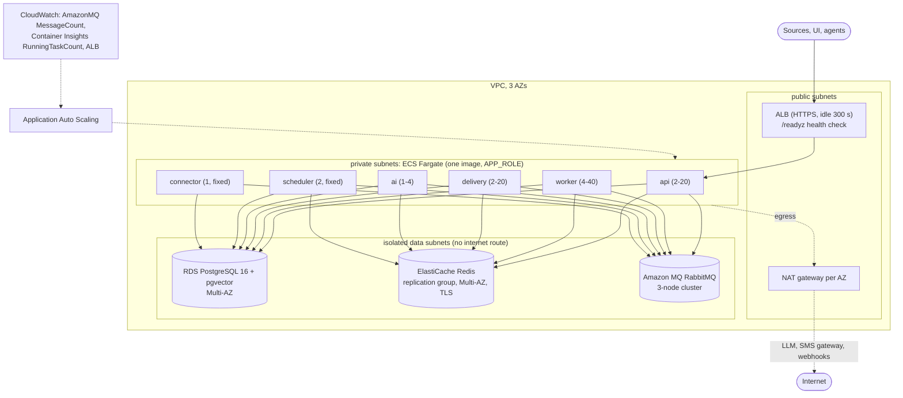

# gs-alerting on AWS (Terraform)

A production-grade, horizontally scalable AWS deployment of the alerting service: ECS Fargate for the six
stateless roles, RDS PostgreSQL 16 (pgvector), ElastiCache Redis and Amazon MQ for RabbitMQ.

> **Status: validated, not applied.** This code passes `terraform fmt -check` and `terraform validate`
> (Terraform 1.9, AWS provider ~> 5.60). It has **never been applied**: there is no AWS account behind the
> hackathon. Expect small provider-level adjustments on a first real `apply` (see *Risks*). Everything
> measured in the main README was measured on the Docker Compose stack, not on this deployment.

## Architecture



Layout:

```
infra/terraform/
  modules/network   VPC, 3x public/private/data subnets, IGW, NAT per AZ, S3 endpoint, ALB + task security groups
  modules/ecr       image repository (immutable tags, scan on push, lifecycle)
  modules/data      RDS, ElastiCache, Amazon MQ, data security groups, Secrets Manager secrets
  modules/alb       ALB, HTTPS listener, api target group, optional Route53 alias and WAF
  modules/ecs       cluster, per-role task definition / service / IAM / log group, autoscaling.tf
  modules/ses       optional SES domain identity + SMTP credentials
  environments/prod root module: main.tf, variables.tf, outputs.tf, backend.tf (example), terraform.tfvars.example
```

Security: only the task security group reaches RDS (5432), Redis (6379) and MQ (5671, AMQPS); data subnets
have no route to the internet; everything is encrypted at rest and in transit (RDS `rds.force_ssl`, Redis
`rediss://`, `amqps://`). Each role has its own execution role that can read only its own secrets, and a task
role with **no permissions** (the app never calls AWS APIs). Secrets (`DATABASE_URL`, `REDIS_URL`,
`RABBITMQ_URL`, `JWT_SECRET`, `APP_SECRET`) are generated and injected through ECS `secrets`;
`ANTHROPIC_API_KEY` and `INBOUND_SMS_SECRET` are created with a placeholder and set out of band.

## What scales on what signal

| Role | Policy | Signal | Bounds (default) |
| --- | --- | --- | --- |
| `api` | target tracking | `ALBRequestCountPerTarget` (6,000 req/min/task) and ECS CPU 60 % | 2 - 20 |
| `worker` | target tracking (metric math) | backlog per task = `AWS/AmazonMQ MessageCount{events.in}` / `RunningTaskCount`, target 5,000; CPU 60 % | 4 - 40 |
| `worker` | **step** (storm surge) | alarm when `events.in` > 50,000 for 2 min: +50 %, +100 % beyond 100,000 | |
| `delivery` | target tracking (metric math) | sum of `MessageCount` over `deliveries.{ui,email,sms,phone,webhook}` / `RunningTaskCount`, target 2,000; CPU 60 % | 2 - 20 |
| `ai` | target tracking | ECS CPU 60 % (off the hot path, capped on purpose) | 1 - 4 |
| `scheduler` | fixed | 2 replicas for HA; safe because every job claims rows with `FOR UPDATE SKIP LOCKED` (`app/escalation/jobs.py`, `app/core/outbox_relay.py`) | 2 |
| `connector` | fixed | RabbitMQ competing consumers acking after our publisher confirm (`app/connectors/rabbitmq.py`) | 1 |

Scale-out cooldown is 30-60 s, scale-in 300 s. Scaling on **queue depth per task** (not raw depth) keeps time to
drain constant as the fleet grows, and the priority queues keep critical alerts first while it catches up.
Bounds are variables (`service_sizing`) in `environments/prod/variables.tf`. Container Insights is enabled on
the cluster because it provides `RunningTaskCount`.

## Failure modes

| Failure | What happens | Why nothing is lost |
| --- | --- | --- |
| Task dies / deploy | ECS replaces it; ALB drains api for 60 s; roles get 120 s (`stopTimeout`) to finish in-flight work | Unacked RabbitMQ messages are redelivered; alert upsert and `deliveries.idempotency_key` make replays idempotent (T4: worker `SIGKILL`, 0 lost) |
| AZ loss | ALB stops routing to the AZ, ECS reschedules tasks into the other two subnets, RDS and Redis fail over, the MQ cluster keeps quorum with 2 of 3 nodes | Same as above; the minimum counts are sized so that two AZs still carry baseline load |
| RabbitMQ node loss | Clients reconnect through the cluster endpoint (connection loss ends the session and the supervisor reconnects with backoff); the API answers `503 Retry-After` only while no confirm can be obtained | We never accept (202) what the broker has not confirmed; delivery messages are also in the Postgres **outbox**, and the scheduler's relay republishes rows with `published_at IS NULL` |
| RDS failover (60-120 s) | The commit fails, so the message is not acked and is redelivered; the API pool reconnects | The event stays in `events.in` until its transaction commits; alert, deliveries and outbox rows are written in **one** transaction |
| Redis failover | Rate limits / SSE fan-out pause; workers requeue | Redis holds only ephemeral state; the outbox relay does not depend on it |
| Provider outage (SMS, email) | Retry after 5 s / 30 s, then `deliveries.dlq`, status `dead_lettered`, fallback channel (`phone -> sms -> email`) | T4: SMS gateway down 60 s, **0 lost**. A CloudWatch alarm fires when `deliveries.dlq` is not empty |

## Capacity estimate (grounded in the measured numbers; unmeasured on AWS)

From the main README (Docker Compose on one 10-core MacBook with k6, Postgres, RabbitMQ and AI on the same host,
worst case: every matching event is a new alert): one worker process is about **1,250 ev/s** (T5), 4 workers
sustain **1,500-2,500 ev/s** (T2), ingest to UI **p99 52 ms** at 100 ev/s (T1), **0 lost** under chaos (T4).

Assumption for planning: a 1-vCPU Fargate worker sustains roughly 800 ev/s (conservative: a laptop core is faster
than a shared Fargate vCPU).

| Fleet | Worker capacity | Likely first bottleneck |
| --- | --- | --- |
| Baseline, 4 workers | about 3,200 ev/s | Postgres commits on `db.r6g.large`; the measured 1,500-2,500 ev/s on a *shared laptop* is the lower bound |
| 10 workers | about 8,000 ev/s on paper | Postgres write throughput: move to `db.r6g.2xlarge` / provisioned IOPS; dedup collapses duplicates, so real storms are cheaper than the worst case |
| 40 workers (max) | RabbitMQ and Postgres, not the workers | Amazon MQ node size (`mq.m5.2xlarge`) and an RDS write-scaling plan |

The 1,000 ev/s target and 100 ev/s latency profile fit comfortably in the baseline. Validate on AWS with
`loadtest/` (k6) pointed at the ALB before quoting numbers beyond the table above.

## Rough monthly cost (estimate, on-demand, eu-central-1, USD, +/- 30 %)

Baseline: 2 api, 4 worker, 2 delivery, 1 ai, 2 scheduler, 1 connector (Fargate ARM64), `db.r6g.large` Multi-AZ,
`cache.r6g.large` x2, `mq.m5.large` 3-node cluster, NAT per AZ. Prices are rounded list prices from memory:
check the AWS Pricing Calculator before using them anywhere that matters.

| Item | Basis | USD / month |
| --- | --- | --- |
| Fargate tasks | 10.5 vCPU, 21 GiB (api 2, worker 4, delivery 1, ai 2, scheduler 1, connector 0.5 vCPU) | 300 |
| RDS PostgreSQL 16 Multi-AZ | `db.r6g.large` x2 | 400 |
| RDS storage | 200 GiB gp3 Multi-AZ + backups | 50 |
| ElastiCache Redis | `cache.r6g.large` x2 (primary + replica) | 330 |
| Amazon MQ RabbitMQ | `mq.m5.large` x3 cluster + storage | 630 |
| NAT gateways | 3 + data processing | 145 |
| ALB | 1 ALB + LCUs | 35 |
| CloudWatch, Container Insights, Secrets Manager, ECR | logs and metrics | 45 |
| **Total** | | **about 1,950** |

Cheaper non-production variants: `single_nat_gateway = true`, `mq_deployment_mode = "SINGLE_INSTANCE"`,
`db_multi_az = false`, one Redis node (about 1,050 / month).

## Deploy

Prerequisites: AWS credentials, an ACM certificate in the region, optionally a Route53 hosted zone, Docker with
buildx.

```bash
cd infra/terraform/environments/prod
cp terraform.tfvars.example terraform.tfvars          # edit domain, certificate, image_tag
# optional: uncomment backend.tf for S3 + DynamoDB remote state

terraform init
terraform apply -target=module.ecr                    # 1. the registry must exist before the image
ECR=$(terraform output -raw ecr_repository_url)
aws ecr get-login-password | docker login --username AWS --password-stdin "${ECR%%/*}"
docker buildx build --platform linux/arm64 -t "$ECR:<image_tag>" --push ../../../../backend   # matches cpu_architecture

terraform plan -out tfplan && terraform apply tfplan  # 2. everything else

aws secretsmanager put-secret-value --secret-id gs-alerting-prod/ANTHROPIC_API_KEY --secret-string "$ANTHROPIC_API_KEY"
aws ecs update-service --cluster gs-alerting-prod --service ai --force-new-deployment
```

Outputs: `alb_dns_name`, `ecr_repository_url`, `ecs_cluster_name`.

**Migrations.** The `api` role applies `backend/migrations/*.sql` at startup (`app/api/app.py` lifespan calls
`run_migrations`, serialized by a Postgres advisory lock, so several replicas starting together are safe) and
`CREATE EXTENSION vector`. The other roles do not migrate: on the very first deploy they may restart a few times
until the api has created the schema, which the ECS circuit breaker tolerates. For later releases, deploy the
api first, then the rest (push a new immutable `image_tag` and `terraform apply`).

## Risks and TODO (honest list)

- **Never applied.** Verify on a first apply in a sandbox account; the Amazon MQ cluster subnet placement and
  CloudWatch dimensions (`Broker`, `VirtualHost`, `Queue` under `AWS/AmazonMQ`) are the most likely adjustments.
- **Queue replication.** The app declares classic durable queues with `x-max-priority`. Quorum queues (the
  replicated type on current RabbitMQ) do not support our priority scheme, so on a node loss the queues hosted
  on that node are unavailable until it returns, while messages in them survive (persistent). Move to a
  replication policy or a quorum design before relying on zero-downtime broker node failover.
- **Email via SES** needs SMTP auth and STARTTLS support in `app/delivery/channels/email.py`
  (it currently uses plain `aiosmtplib.send` without credentials); the `SMTP_USER` / `SMTP_PASSWORD` secrets
  are provisioned and injected, the application side is not wired. Alternative: an authenticated SMTP relay.
- **Read replica** (`db_read_replica_count`) is provisioned but the application does not read from it yet.
- **State holds generated passwords**; use the encrypted S3 backend with restricted access.
- No Fargate Spot (workers tolerate interruption thanks to at-least-once delivery; an easy later saving), no
  multi-region.
