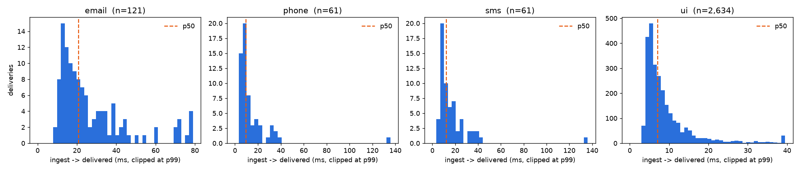
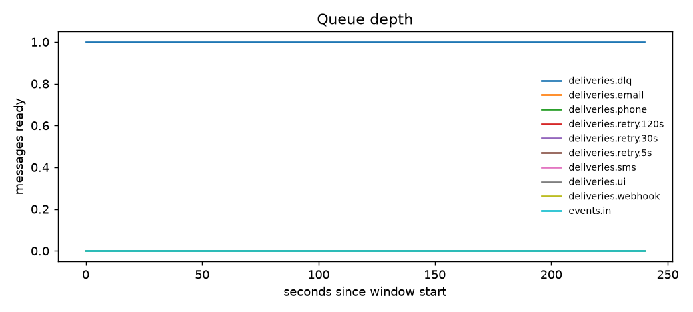
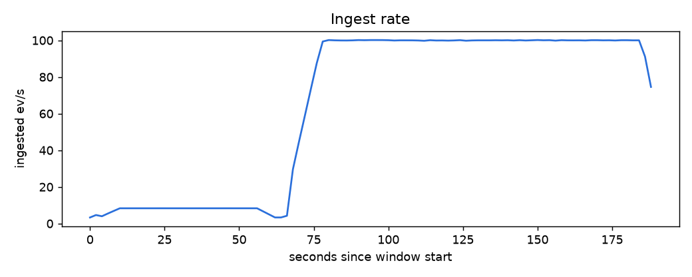

# Load test report 2026-11-21 01:32 UTC

- window: 2026-11-21 01:28:45 to 2026-11-21 01:32:45 UTC
- API: http://localhost:8080

## T1 latency (100 ev/s, mixed, 20 % matching)

- run id: `ltmwpqedlqjj`, 120 s
- window: 2026-11-21T01:30:40.094Z to 2026-11-21T01:32:40.103Z
- events accepted 12,001, rejected 0, http requests 12,001
- API http latency p50 3.4 ms, p95 20.7 ms, p99 36.0 ms
- http failure rate 0.00 %

### Delivery latency per channel (`delivered_at - event_received_at`, SQL)

| Channel | n | p50 | p95 | p99 | max | Target |
| --- | ---: | ---: | ---: | ---: | ---: | --- |
| email | 121 | 20.8 ms | 71.8 ms | 79.0 ms | 156 ms | PASS (p99 < 1000 ms) |
| phone | 61 | 9.3 ms | 34.3 ms | 78.5 ms | 136 ms | PASS (p99 < 1000 ms) |
| sms | 61 | 12.2 ms | 37.8 ms | 79.6 ms | 136 ms | PASS (p99 < 1000 ms) |
| ui | 2,634 | 7.0 ms | 21.9 ms | 39.4 ms | 135 ms | PASS (p50 < 50 ms, p99 < 300 ms) |

### Alert creation latency (`created_at - first_event_received_at`, SQL)

| Channel | n | p50 | p95 | p99 | max |
| --- | ---: | ---: | ---: | ---: | ---: |
| alerts | 2,634 | 1.6 ms | 6.8 ms | 15.6 ms | 47.7 ms |

## T2 throughput (ramping, batch endpoint)

n/a (no k6 summary found; run the test first)

## T4 chaos (no loss)

n/a (run `make t4`)

## T5 scaling

n/a (run `make t5`)

## T6 dedup (500 identical events)

- run id: `ltmwpqcwz8sp`, 60.4 s
- window: 2026-11-21T01:29:31.892Z to 2026-11-21T01:30:32.245Z
- events accepted 500, rejected 0, http requests 500
- API http latency p50 8.5 ms, p95 45.3 ms, p99 56.7 ms
- http failure rate 0.00 %

## Pipeline metrics (Prometheus)

- processing latency (all events in window) p50 3.5 ms, p99 47.2 ms
- ingested events 12,401
- outcomes: alerted_new 2,633, deduplicated 480, unrouted 9,254
- peak queue depth: deliveries.dlq 1, deliveries.email 0, deliveries.phone 0, deliveries.retry.120s 0, deliveries.retry.30s 0, deliveries.retry.5s 0, deliveries.sms 0, deliveries.ui 0, deliveries.webhook 0, events.in 0

## Charts

