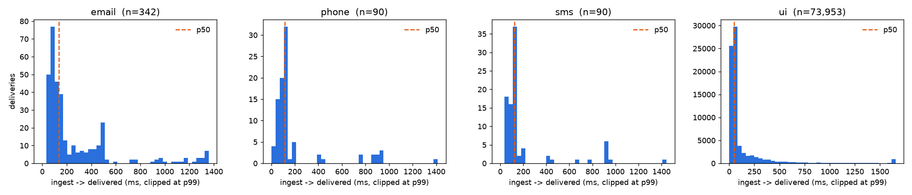
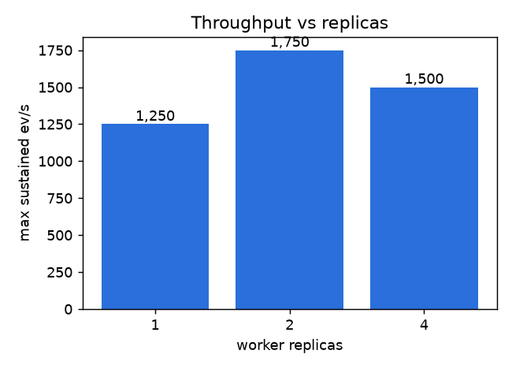
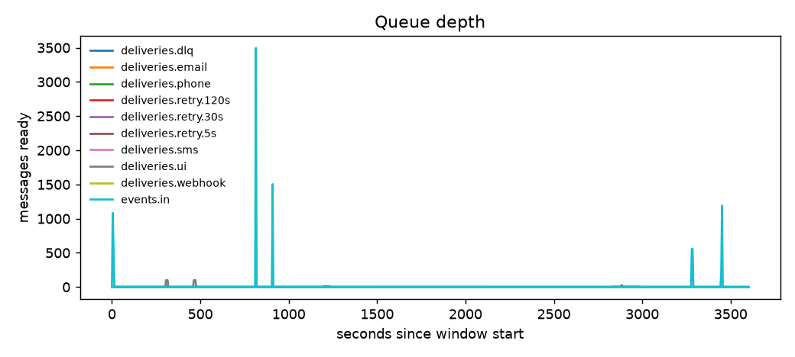
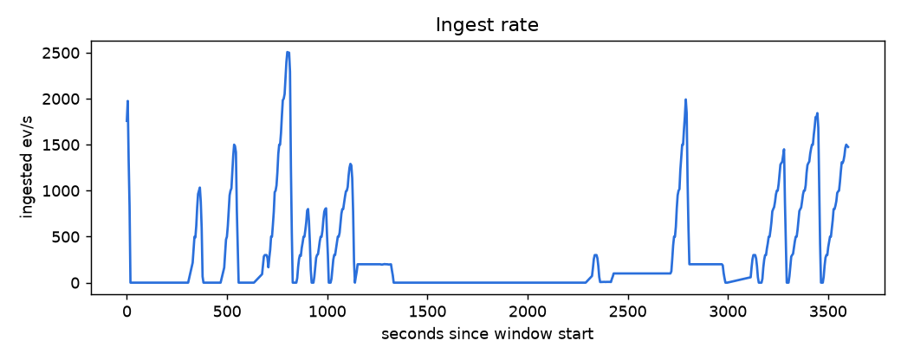

# Load test report 2026-11-21 02:52 UTC

- window: 2026-11-21 01:52:02 to 2026-11-21 02:52:02 UTC
- API: http://localhost:8080

## T1 latency (100 ev/s, mixed, 20 % matching)

- run id: `ltmwpslmv8tc`, 300 s
- window: 2026-11-21T02:32:17.924Z to 2026-11-21T02:37:17.941Z
- events accepted 30,001, rejected 0, http requests 30,001
- API http latency p50 1.8 ms, p95 2.9 ms, p99 4.4 ms
- http failure rate 0.00 %

### Delivery latency per channel (`delivered_at - event_received_at`, SQL)

| Channel | n | p50 | p95 | p99 | max | Target |
| --- | ---: | ---: | ---: | ---: | ---: | --- |
| email | 342 | 134 ms | 1,150 ms | 1,356 ms | 1,406 ms | FAIL (p99 < 1000 ms) |
| phone | 90 | 116 ms | 889 ms | 994 ms | 1,412 ms | PASS (p99 < 1000 ms) |
| sms | 90 | 122 ms | 923 ms | 1,002 ms | 1,444 ms | FAIL (p99 < 1000 ms) |
| ui | 73,953 | 49.0 ms | 557 ms | 1,655 ms | 2,358 ms | FAIL (p50 < 50 ms, p99 < 300 ms) |

### Alert creation latency (`created_at - first_event_received_at`, SQL)

| Channel | n | p50 | p95 | p99 | max |
| --- | ---: | ---: | ---: | ---: | ---: |
| alerts | 73,953 | 20.9 ms | 289 ms | 1,559 ms | 2,225 ms |

## T2 throughput (ramping, batch endpoint)

- run id: `ltmwpss2isxw`, 76 s
- window: 2026-11-21T02:37:18.148Z to 2026-11-21T02:38:34.144Z
- events accepted 91,100, rejected 0, http requests 963
- API http latency p50 12.2 ms, p95 60.5 ms, p99 846 ms
- http failure rate 0.00 %
- max sustained: **1,500 ev/s**, accepted average 1,199 ev/s, stop reason: threshold abort (http errors / http p99 / processing p99 / backlog)

## T4 chaos (no loss)

```
queues drained=True after 4s
== Reconciliation (T4) ==
events accepted by API (k6 202s) : 36001
prometheus ingested_total        : 58001
outcomes                         : alerted_new=11460, deduplicated=0, grouped=0, unrouted=45797, invalid=0  (sum 57257)
counter gap (accepted - outcomes): -21256  counted as lost: 0
alerts expected / found          : 6454 / 6454  lost: 0
deliveries created               : 22966
  delivered (ok statuses)        : 7332
  dead-lettered, fallback ok     : 0 (dead-lettered total 0)
  suppressed_digest              : 15634
  unaccounted                    : 0
  by status                      : {'suppressed_digest': 15634, 'delivered': 7272, 'sent': 60}
queue residue after drain        : 0
note: outcomes exceed accepted by 21256: redelivered messages counted twice
LOST = 0
/v1/metrics/summary: lost=0 ingested=166602
```

## T5 scaling

| Workers | Max sustained ev/s | Stop reason |
| ---: | ---: | --- |
| 1 | 1,250 | threshold abort (http errors / http p99 / processing p99 / backlog) |
| 2 | 1,750 | threshold abort (http errors / http p99 / processing p99 / backlog) |
| 4 | 1,500 | threshold abort (http errors / http p99 / processing p99 / backlog) |

## T6 dedup (500 identical events)

- run id: `ltmwpska93wj`, 60.5 s
- window: 2026-11-21T02:31:14.919Z to 2026-11-21T02:32:15.381Z
- events accepted 500, rejected 0, http requests 500
- API http latency p50 16.9 ms, p95 28.2 ms, p99 81.1 ms
- http failure rate 0.00 %

## Pipeline metrics (Prometheus)

- processing latency (all events in window) p50 22.6 ms, p99 2,156 ms
- ingested events 1,007,135
- outcomes: alerted_new 201,189, deduplicated 480, unrouted 803,326
- peak queue depth: deliveries.dlq 4, deliveries.email 30, deliveries.phone 9, deliveries.retry.120s 0, deliveries.retry.30s 10, deliveries.retry.5s 27, deliveries.sms 9, deliveries.ui 100, deliveries.webhook 0, events.in 3,496

## Charts





